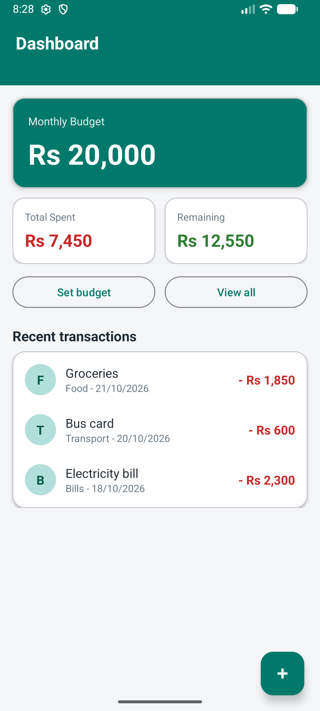
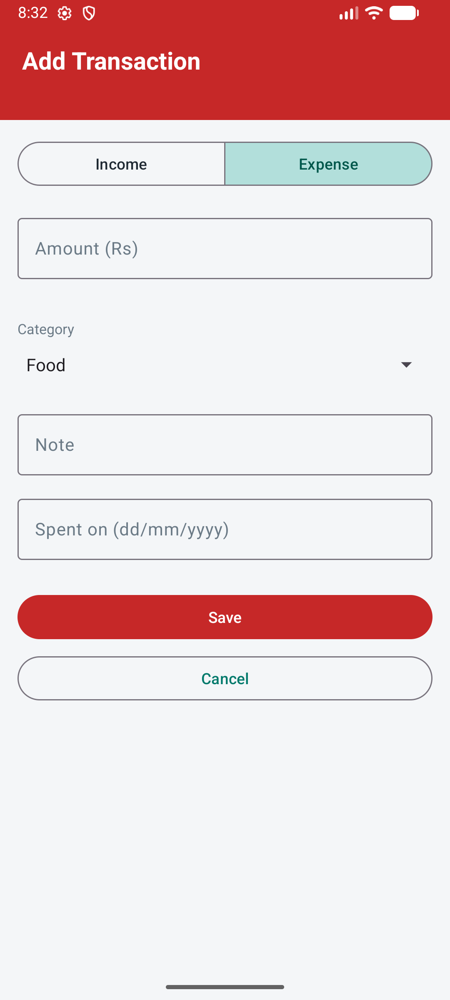
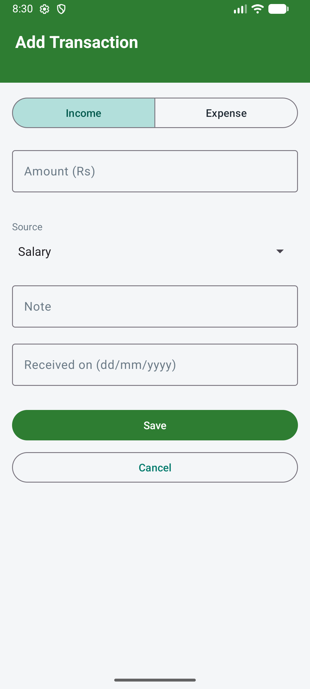
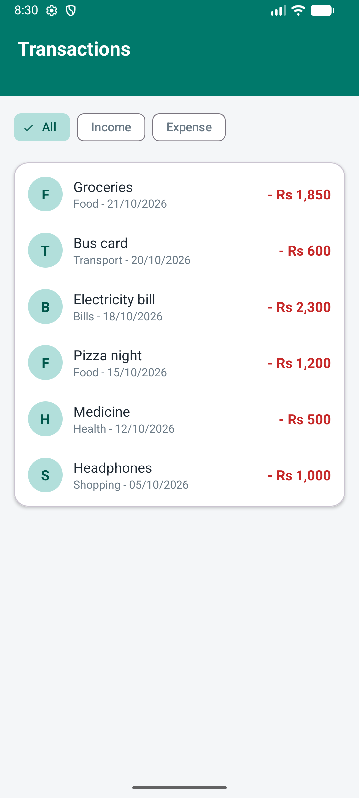
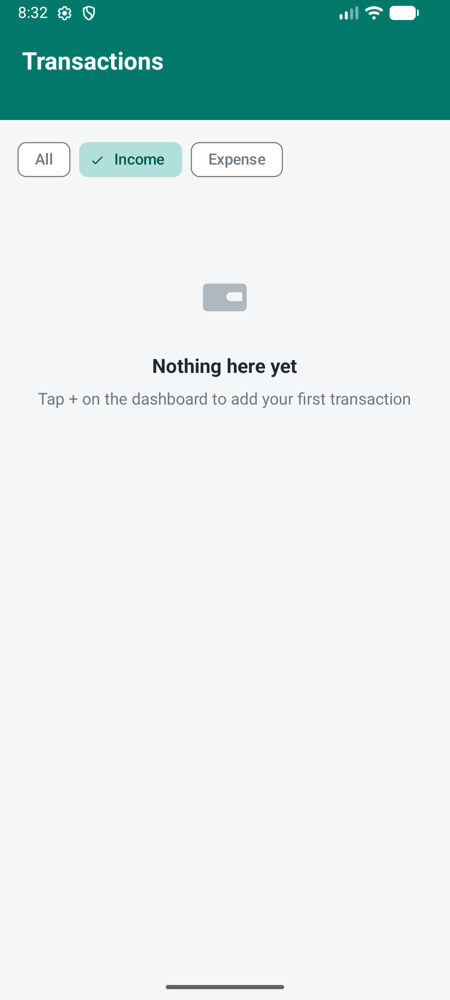
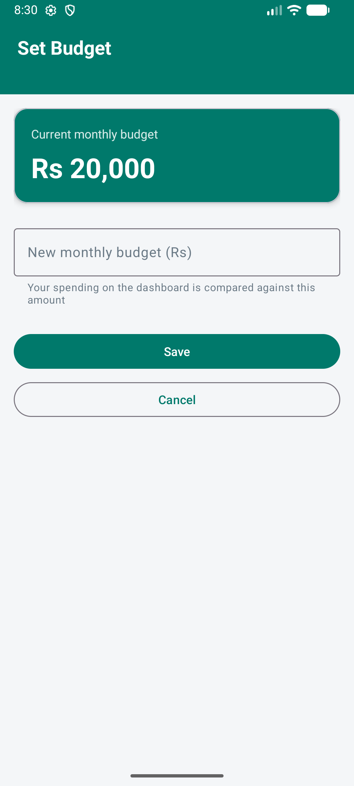
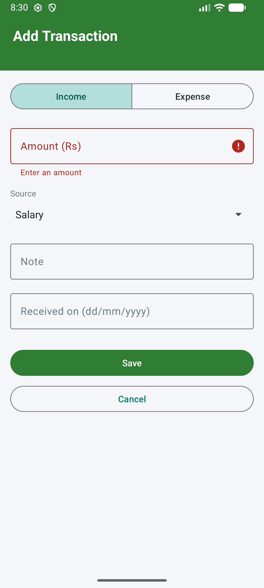
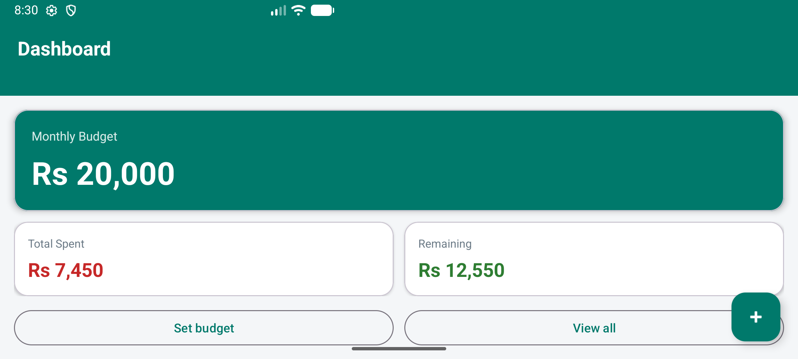
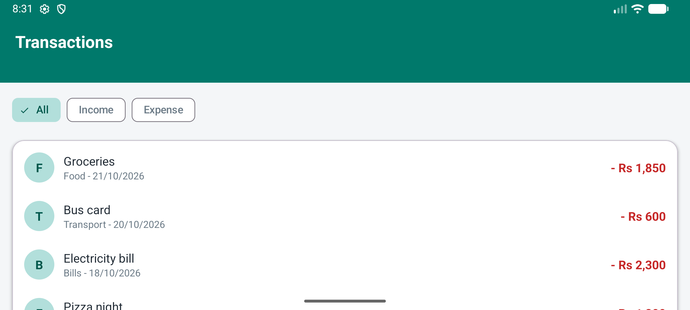

# Budget Tracker

Mobile Application Development (CS02310), Section W, lab project.

| Member                 | SAP ID   |
|------------------------|----------|
| Hafiz Muhammad Haris   | 70143269 |
| Eesha Zafar            | 70145352 |

A simple Android app (Java + XML) where a user sets a monthly budget, adds income and
expense entries, views all transactions, and sees the remaining balance and spending
per category. All data stays on the device (SQLite + SharedPreferences).

## Stack

- Language: Java 17
- UI: XML layouts, Material Components (cards, buttons, text fields, chips)
- Storage: SQLite via `SQLiteOpenHelper` (transactions), `SharedPreferences` (budget)
- Navigation: Activities + Intents
- Min SDK 26 (Android 8.0), target SDK 37

## Task progress

| Task | Status | Tag | What it delivers |
|------|--------|-----|------------------|
| 1 | Done | `task-1` | UI and layouts: Splash, Home, Add Transaction, Transactions list, Set Budget. Static sample data, placeholder actions. |
| 2 | Next | | Transaction model, SQLite helper, input validation, real saving |
| 3 | | | RecyclerView list, filters, edit and delete, budget stored in SharedPreferences |
| 4 | | | Category summary, app icon, About screen, testing and final docs |

## Screens and user journey (Task 1)

```
Splash  -->  Home (dashboard)  -->  Add Transaction
                  |
                  +-->  Transactions (All / Income / Expense filter, empty state)
                  |
                  +-->  Set Budget
```

Main user: a student or salaried person who wants to see how much of this month's
budget is left. Core features: set a monthly budget, add income or expense entries,
view all transactions with a filter, see spent and remaining on one dashboard.

| Home | Add Transaction (Expense) | Add Transaction (Income) |
|---|---|---|
|  |  |  |

| Transactions | Empty state | Set Budget |
|---|---|---|
|  |  |  |

| Error area | Home, landscape | Transactions, landscape |
|---|---|---|
|  |  |  |

## Setup and run

Required tools: Android Studio (2026.x or newer). It ships its own JDK and Android SDK,
so nothing else needs installing.

1. `git clone https://github.com/harisizm/Budget-tracker-mad.git` and open the folder in Android Studio.
2. Let Gradle sync (it downloads the Android plugin and libraries the first time).
3. Create a virtual device in Device Manager if none exists (any phone, API 26+).
4. Press Run. The app opens on Splash and moves to Home after two seconds.

Command-line build check: `gradlew assembleDebug` (Windows: `gradlew.bat assembleDebug`).

## Database configuration

None yet. Task 1 uses hard-coded sample data in `SampleData.java`. Task 2 adds the
SQLite database, which the app creates on first launch with no manual steps.

## Project structure

```
app/src/main/
  AndroidManifest.xml                 every screen is declared here
  java/com/mad/budgettracker/
    SplashActivity.java               2 s delay, then opens Home
    HomeActivity.java                 dashboard cards, recent rows, shortcuts
    AddTransactionActivity.java       form; Income/Expense toggle re-skins it
    TransactionListActivity.java      full list with filter chips and empty state
    SetBudgetActivity.java            budget form
    SampleData.java                   static rows used until Task 2
  res/layout/                         one activity_xxx.xml per screen + item_transaction.xml
  res/values/                         strings.xml, colors.xml, themes.xml
docs/screenshots/                     evidence per task
```

## Known limitations (Task 1)

- Save on Add Transaction and Set Budget only shows a message; nothing is stored yet.
- Amounts and the transaction rows are static sample data.
- Only the empty-amount check exists; full validation comes in Task 2.
- The splash screen shows black on the Android 17 preview emulator image (an emulator
  issue with the first activity of a cold start); it renders normally on stable images
  and real phones.
